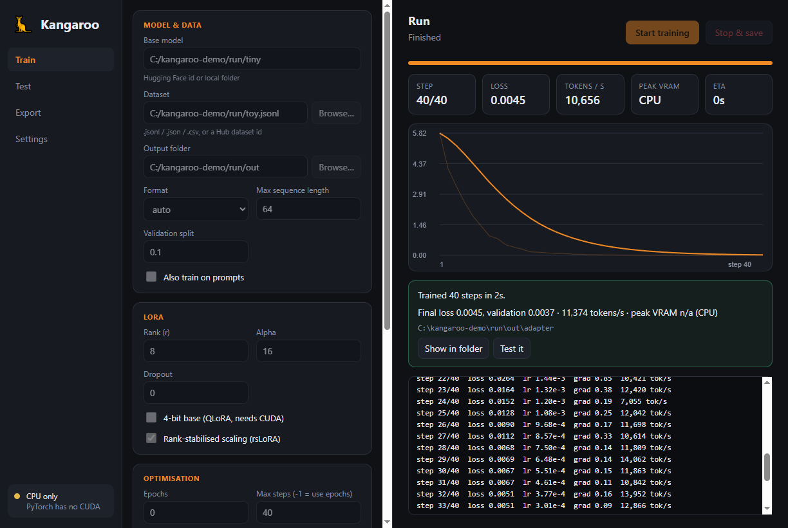

# 🦘 Kangaroo

### Fine-tune your own LLM on your own GPU. Lean, fast to set up, and a pleasure to use.

Kangaroo is a desktop app for **LoRA and QLoRA fine-tuning** that gets out of your way. Pick a model, drop in a dataset,
press **Start**. Watch the loss curve, test the result, export a merged model. No notebooks, no config wrangling.

Under the hood is a small, readable engine built on plain **PyTorch + Transformers + PEFT**, designed around the things
that cost the most memory and time in a LoRA run. It is free, open and public domain.



<sup>A short demo run on a tiny model, so you can see the live loss curve, stats and results card.</sup>

## Why you'll like it

- 🖥️ **A real desktop app.** Live loss chart, tokens/s, peak VRAM and ETA. Stop at any time and your adapter is still saved.
- 🪶 **Lightweight.** Three core dependencies (`torch`, `transformers`, `peft`) and a ~1k-line engine you can read in an afternoon.
- 🧠 **Memory-smart by design.** The training loop is built to keep VRAM free for what matters: bigger batches, longer sequences, bigger models.
- ⚡ **Low overhead.** No Trainer/Accelerate layers; fused AdamW, SDPA attention, bf16 autocast.
- 🎯 **Quality first.** Standard LoRA/QLoRA maths, exact (not approximate) loss, completion-only training by default.
- 📦 **One-click Windows installer** with a built-in engine setup. No terminal needed.
- 🔓 **Unlicense.** Public domain. Use it, fork it, ship it.

## Get started in 3 minutes

### Windows installer

1. Download **`Kangaroo-Setup-0.1.0.exe`** from the [latest release](https://github.com/ahpah-dev/kangaroo/releases/latest).
2. Run it. (Windows may show a SmartScreen prompt for new unsigned apps: click *More info → Run anyway*.)
3. Open Kangaroo and press **Install engine**. It detects your NVIDIA GPU and sets up PyTorch for you
   (needs Python 3.10+ installed; the GPU build is a ~3 GB one-time download).
4. Choose a base model and a dataset, then hit **Start training**.

### From source

Requirements: Python ≥ 3.10, Node ≥ 20, and an NVIDIA GPU with a recent driver for fast training.

```powershell
# Windows
powershell -ExecutionPolicy Bypass -File scripts\setup.ps1          # CUDA 12.8 build (RTX 50-series OK)
powershell -ExecutionPolicy Bypass -File scripts\setup.ps1 -Torch cpu
```

```bash
# Linux / macOS
bash scripts/setup.sh            # or: bash scripts/setup.sh cu126 | cpu
```

Then:

```bash
cd app
npm start
```

## The workflow

1. **Train**: pick a base model (any Hugging Face id or local folder) and a dataset, tune LoRA and optimisation settings, go.
2. **Test**: chat with your adapter straight away; tokens stream in live.
3. **Export**: merge the adapter into the base weights and save standard safetensors that load anywhere. For GGUF, run
   llama.cpp's `convert_hf_to_gguf.py` on the output folder.

### Bring your data as-is

Local `.jsonl`, `.json`, `.csv`, `.tsv`, or any Hugging Face Hub dataset. The format is auto-detected:

| Format | Record |
|---|---|
| `alpaca` | `{"instruction": "...", "input": "...", "output": "..."}` |
| `chat` | `{"messages": [{"role": "user", "content": "..."}, {"role": "assistant", ...}]}` or ShareGPT `{"conversations": [{"from": "human", "value": ...}]}` |
| `prompt_completion` | `{"prompt": "...", "completion": "..."}` |
| `text` | `{"text": "..."}` (learn from everything) |

Kangaroo uses your model's own chat template automatically, and trains on the assistant's answer by default (turn on
*Also train on prompts* if you want both).

## What makes it efficient

| Technique | What you get |
|---|---|
| **Chunked, checkpointed cross-entropy** | Never builds the giant `[tokens × vocab]` fp32 logits tensor, often the biggest allocation in a LoRA step with modern 128k–256k vocabularies. Mathematically identical to the dense loss (tested, gradients included). |
| **Only answer tokens reach the LM head** | Prompt tokens skip the vocabulary projection entirely. |
| **Token-budget, length-bucketed batching** | Similar-length examples are batched together up to a token budget: very little padding, predictable memory, and no cross-example attention leakage. The app shows your padding efficiency. |
| **Auto activation checkpointing** | On CUDA, Kangaroo tries your biggest batch without checkpointing and only turns it on if it's needed, so you skip the recompute whenever it fits. |
| **Lean training loop** | Token-weighted loss across gradient accumulation, fused AdamW, bf16 autocast over fp32 LoRA weights. |
| **QLoRA built in** | NF4 + double quantisation via bitsandbytes to fit bigger models on smaller cards. |

## Scriptable too

The app is a thin shell around a clean CLI, so everything is automatable:

```bash
python -m kangaroo train --model Qwen/Qwen2.5-0.5B-Instruct --dataset data.jsonl --output-dir out --epochs 1
python -m kangaroo train --config run.json            # same keys as JSON; flags override
python -m kangaroo generate --adapter out/adapter --prompt "Hello"
python -m kangaroo export --adapter out/adapter --output-dir merged
python -m kangaroo info
```

`train` accepts every field of [`TrainConfig`](src/kangaroo/config.py) as a flag (`--lora-r 32`, `--no-rslora`,
`--gradient-checkpointing off`, …) and streams JSON-lines events, documented in [docs/DESIGN.md](docs/DESIGN.md).

## Measure your own speed-up

Every run ends with average real tokens/s and peak VRAM, so comparing is easy: use the same model, dataset, sequence
length, LoRA settings and effective batch (Kangaroo's `batch_tokens × grad_accum` is its effective batch in tokens) and
compare **tokens/s, peak VRAM and eval loss** against whatever you use today. We'd love to see your numbers; share them in
an issue.

## Works with

Text LLMs supported by Transformers whose backbone exposes `model.base_model`: Llama, Qwen, Mistral, Gemma, Phi,
SmolLM and many more. LoRA adapters on a single GPU, with a CPU fallback for experimenting.

## Status & roadmap

Kangaroo is an **early release (v0.1)**. The engine and app are fully tested end to end on CPU, and the CUDA path is
implemented and waiting for you to put it through its paces: reports from different GPUs are very welcome.

Coming next: published benchmarks, fused kernels for even more speed, sequence packing, DoRA, resume-from-checkpoint,
signed installers, macOS/Linux packages, and a bundled Python so setup is truly one click.

## Contributing & development

PRs and issues are welcome.

```bash
python -m pip install -e ".[dev]"
python -m pytest                 # engine tests (CPU, offline, ~30 s)
cd app && npm install && node --test
bash scripts/smoke-e2e.sh        # drives the real Electron UI end to end (CPU, offline)
cd app && npm run dist           # builds dist/Kangaroo-Setup-<version>.exe
```

Layout: `src/kangaroo/` engine · `app/` Electron shell (`engine.js` supervises Python, `setup.js` is the first-run
installer, `renderer/` is plain HTML/JS) · `tests/` · `scripts/`.

## License

[The Unlicense](LICENSE): public domain. Do whatever you like.
